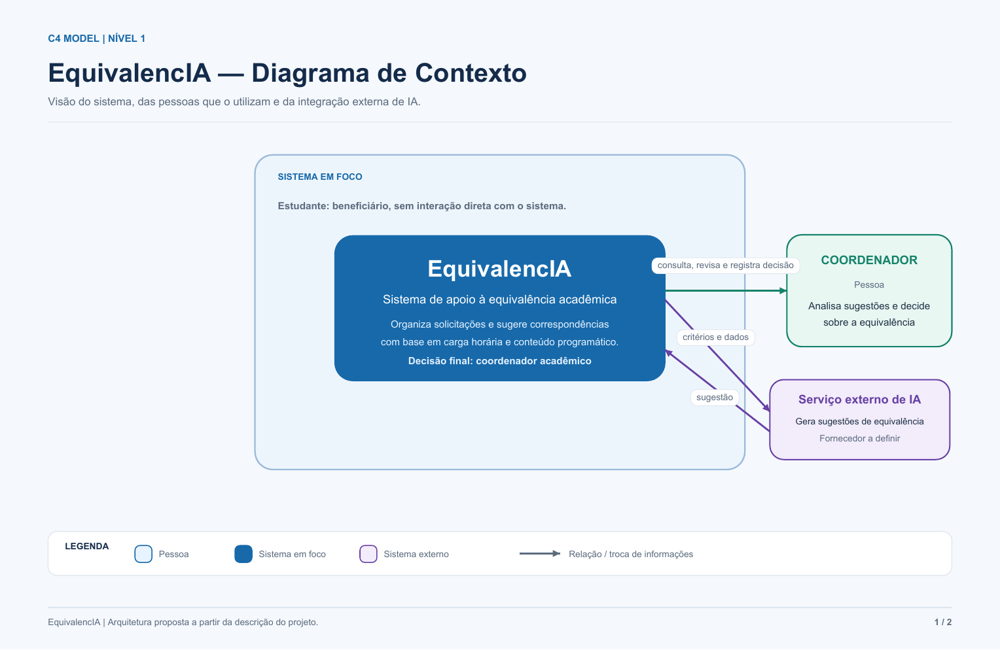
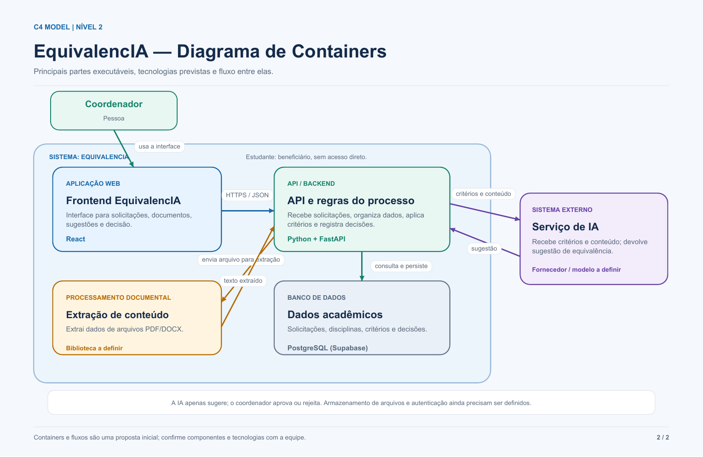

# EquivalencIA — Arquitetura

## Visão geral

O **EquivalencIA** apoia a análise de equivalência curricular para aproveitamento de estudos entre instituições de ensino superior. Organiza dados acadêmicos e documentos, compara disciplinas de origem e de destino e apresenta possibilidades de equivalência para revisão humana.

O responsável pela análise curricular (coordenador acadêmico) é o usuário direto do sistema. O estudante é beneficiário do processo; no fluxo documentado, não interage diretamente com o EquivalencIA. O responsável cadastra ou seleciona o estudante e informa seus dados e documentos.

## Diagrama C4 — Nível 1: Contexto

O responsável acessa o EquivalencIA para selecionar o estudante, o curso e a matriz curricular, informar dados, anexar documentos, revisar resultados, validar equivalências e gerar o documento da análise. O sistema utiliza os documentos e dados acadêmicos para apoiar a comparação. A validação acadêmica final é humana.

## Diagrama C4 — Nível 2: Containers

A proposta técnica organiza o portal web em React, uma API em Python com FastAPI, processamento de PDF/DOCX e PostgreSQL hospedado no Supabase. A integração com serviço de IA aparece como proposta técnica a definir; o material de requisitos informa que o processamento automatizado ainda está em desenvolvimento. Qualquer sugestão deve ser revisada pelo responsável.

[Baixar os diagramas C4 em PDF](assets/EquivalencIA_C4_Niveis_1_e_2.pdf)

## Tecnologias previstas

| Parte | Tecnologia |
|---|---|
| Interface web | React |
| API e regras do processo | Python + FastAPI |
| Banco de dados | PostgreSQL (Supabase) |
| Leitura de documentos | PDF e DOCX; biblioteca a definir |
| Sugestões automatizadas | Processamento/IA em desenvolvimento; provedor a definir |

O armazenamento de arquivos e a autenticação ainda precisam ser definidos pela equipe. A extração documental pode ser implementada como módulo da API ou serviço separado, conforme a arquitetura final.
